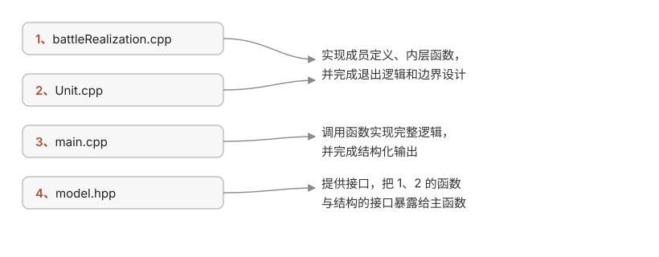

## 小雅

江天无尘，西山外，晚来还卷，一帘秋霁。烟汀凫渚，皆着粉黛之色，可怜可爱。若是楚臣灵均见，此南艳湖畔粉黛之色，是否扼腕叹息。只惜潇湘南国，不同天都裙带，据下万物皆钟灵硫秀，养胭脂美人、文峰俊郎。穷天之际，极海之涯，慨然有游目骋怀之感，欲于江渚之上酾酒临江、横架赋诗，似有蛟龙潜渊、鲲鹏戾天，又欲于层宇之上，看素秋干顷、玉做人间。自蜀山楚水始，文从离骚，诗追风雅，虽长吟短叹，而自嗟弗如远届。

冷丝织雨，飘零庐郡，来寄修椽：夏宜急雨，有碎玉声；冬宜密雪，有瀑布声；而今听雨如霖铃，寒蝉凄切，绝唱重阳，送秋入安。已而不觉已至霜降，陶色触笔，娑娑莎莎，落叶为毯，偶有狸猫出没，黑白毛发与斜阳暮色并映，见者犹怜。残绿浮日，金掌漫步，行道其间，百事可乐。从执笔构文已去五日天光，如今落成博客已逾期再次，兹勾星带月之辰，从笔有怀，以裨补缺漏。

## 山魈

首先我的项目目标是使用C++实现一个二元PvP战斗内核，并通过主函数实现结果的返回（此处是给人类可读的返回值），在实现过程中为后续增大参与者提供了一定可扩展性，并保留了给LLM阅读的结构化输出的接口。

据此我设计了下面这样一份结构：



虽然整个逻辑并不复杂，总的代码量可能在300到400行的区间，但是我最开始的想法是通过硬编码直接初始化双方参数。

通过我的一些朴素的直觉，容器的可扩展性和语义上的可读性更符合日常的认识，于是本来一个可能一百来行可以全部塞进主函数的程序在我与ds在最初需求和扩展性之间的拉扯中，按照规范的开发流程，将我的逻辑拆分细化成单独可以测试，单独更改的模块。彼时我还不太确定自己想要什么，包括我在跟熟人沟通过程中，也收到了一些避免超前开发的建议（实际上对于我的程序体量，这个的确有些可笑。。。但是平心而论，对于初次尝试个人开发的人来说，这个也能算一次大版本优化了），基于我对技术的自信（我所要写的我所掌握的技术栈——目前都是一些数据结构，足够完全覆盖和复用，不存在搜索等内核级的性能优化也没必要），我选择多花一点时间琢磨透ds给我的结构。

首先，我的思考顺序是决定每个单位的储存结构是：

```cpp
using namespace std

std::unordered_map<long long,Unit>
struct Unit{
	long long id;
	··· //省略一些声明
	···//省略一个构造函数
}
```

这样，我就通过哈希表将 id 确定为玩家的唯一标识符，对于 Unit 中储存的另一份副本我经过权衡，决定使用外加校验函数强制保持键值对中的 id 两份保持一致。我原本仅仅只做了聚合初始化声明，但是后续扩展成了“聚合初始化+构造函数”便于后续加入新成员按照统一规则生成。

后续我需要对于这个哈希表中的元素进行访问和增删改，在这里由于不熟悉，总是重蹈覆辙，也算是给bug捶打得爽滑顺口了（Os: 大半夜提到吃的饿了~咕儿~）。大致都可以通过以下规则辨识和使用：

```cpp
auto& u = units_.at(id);          // 返回 Unit&，直接 u.HP
double hp1 = u.HP;

auto it = units_.find(id);        // find 返回迭代器，不是键值对
if (it != units_.end()) {         // 先确认查到了
    auto& [key, unit] = *it;      // 再解引用，才能结构化绑定
    double hp2 = unit.HP;
}

// 等价的非解构写法（同样要先判 it != end()）：
auto& player = it->second;
double hp3 = player.HP;

// find() 查到时返回指向该键值对的迭代器，查不到返回 .end()；
// 它没有 .empty() 那种布尔返回值，必须显式比较。
// at() 找不到则抛 std::out_of_range。
// 总之：at 适合“我确定它在，不在就是 bug”；find 适合“它可能不在，我要处理这个可能”
```

很显然，如果我们要对哈希表内的所有键值对进行搜索遍历，只关心某个特定 id 是否存在，我们常将其作为键值对整体看。如果我们要对值做增删改操作，我们优先使用 pair 结构化绑定便于我们访问其中特定元素。

对于其中 `&` 这个符号我吃了一次亏，这是一个引用符号，在cpp中广泛应用，是一种与指针具有同等地位的方法——“引用”，而且这里有一个关键区别也是一个优点，引用只绑定一个对象，不可更改，而指针可以更改指向的对象；反之，引用一旦绑定的对象损毁，本身立即失去意义，而指针的对象一旦为空，并不一定出错，这就是指针悬空（当然虽然不出错，也要避免出现空的“野指针”）。还有在定义的时候，unordered_map 容器内默认键值对类型为 const ，所以出现：

```cpp
std::unordered_map<const long long, Unit>
```
这种声明就会报错，在容器内部就相当于写了一个 `const const long long` ，编译器不认识这个类型。因此我们需要在编程中合理使用静态类型和引用。

然后，我其实是直接开始写实现，准备一些增删改的自定义函数，这是因为哈希表中的自定义结构体没有直接调用的标准库，因此需要自己实现。然后准备好接口函数和结构体决定把什么权限交出去，什么权限包装在成员函数内部。人往往受限于一时的视角或者考虑范围，不能够窥见项目的全貌，因此大多是边实现边写接口（其实将接口文件给一个程序员，能够省去很多思考时间，就相当于一个面试官把一份列好题号的算法题单递给你，不需要考虑如何组合）。这里我将我的接口文档贴出，有兴趣的人也许能借此窥见一二：

```cpp
#pragma once
#include<string>
#include<vector>
#include<unordered_map>

struct Unit{
    const long long id;
    double ATK;
    double HP;
    std::string playerName;
    Unit(long long id_,double atk_,double hp_,std::string name_)
    :id(id_),ATK(atk_),HP(hp_),playerName(name_)
    {}
};

class Battle{
public:
    Battle(std::vector<Unit> units,long long firstMoverId);

    double hpOf(long long id) const;
    long long currentActorId() const;
    bool finished() const;
    long long winnerId() const;
    void step();

    bool addPlayer(const Unit& u);
    bool removePlayer(long long id);
    bool updatePlayer(const Unit& u);
    const Unit* findPlayer(long long id);

private:
    void startRound();
    std::vector<long long> order_;
    //本轮的出手顺序，只含存活者
    std::size_t cursor_  = 0;   //本轮轮到第几个
    std::unordered_map<long long, Unit> units_;
    long long firstMoverId_;
};
```

具体的实现过程由于过于重复无味，在此略去，仅保留个人印象较深的点。

在整个实现过程中，我对于cpp的抛错有了新的认识。在一般的算法和数据结构的练习中，我很少会遇到需要我设计供人类阅读的抛错信息，主要都是void声明类型的函数，提供给系统的主函数调用。但是面向人类测试，我又遇到了只有在typescript中才遇到过的 try/throw/catch 这三个函数，还有可以无视函数声明返回类型，错误类型：std::runtime_error / std::invalid_argument，其值一般为一个字符串。在ts中，由于调用方LLM是一个以语言预测为能力底座的程序，所以抛错自然地采用了字面量常量，因而给我的知识迁移提供了便利。

在此之前，我试图通过一些不符合声明的返回值，比如说 -1，-2之类的整型常数表示错误退出码，但是事实上要形成有意义的退出，还要满足几个条件：首先你的函数声明返回值必须包括退出码，其次必须保证语义上，所选择的数字必然不能出现在函数中或者有意义，其次如果有多个错误，必须要建立错误码和数组一一映射，就需要一张枚举表做“翻译”（当然不同的量级有不同的处理方法，这里仅为举例）。以上就有三个条件卡住了我的做法：1、函数声明；2、额外的枚举表维护；3、边界预测。在我的项目体量，直接抛出错误类型显然是性价比最高的选择。

到了构建主函数输出逻辑的时候，我对于我要构建的项目，其中要维护的数据的所属“身份”，不变量和过程量，我还没有很确定的概念。比如说：位置(id)、身份(变量名)、状态(整个unit)。由于我并没有从头设计所有的变量，加上我不熟悉这些数据结构，不能只是看一眼就明白作用，或者类型是否匹配，出现了将对局状态量赋给身份键值引用的笑话。还有随意地选择容器也会给编程带来极大不便，比如说我在选择容器记载轮次历史，来给主函数输出日志的时候，选择了队列 queue ，实际上，如果说我的目的是让地球正常自转，那么我的做法就是让地球倒转——赤道大变了。

但是我仍然让ds为我编辑了一份包含vector和queue两种实现方法的demo，以供参考：

```cpp
#include <iostream>
#include <queue>
#include <vector>
#include "battle/model.hpp"

struct Rec { int step; long long actor; double a, b; };

static void show(const Rec& r) {
    std::cout << r.step << " " << r.actor << " A HP=" << r.a << " B HP=" << r.b << "\n";
}

int main() {
    std::vector<Unit> units;
    units.emplace_back(7, 5, 10, "A");
    units.emplace_back(2, 4, 12, "B");
    Battle b(units, 7);

    std::vector<Rec> v;
    std::queue<Rec> q;
    int n = 0;
    while (!b.finished()) {
        long long actor = b.currentActorId();
        b.step();
        ++n;
        Rec r{n, actor, b.hpOf(7), b.hpOf(2)};
        v.push_back(r);
        q.push(r);
    }

    std::cout << "[vector]\n";
    for (const auto& r : v) show(r);
    std::cout << "size: " << v.size() << "\n";

    std::cout << "[vector again]\n";
    for (const auto& r : v) show(r);
    std::cout << "size: " << v.size() << "\n";

    std::cout << "[queue]\n";
    while (!q.empty()) { show(q.front()); q.pop(); }
    std::cout << "size: " << q.size() << "\n";

    std::cout << "[queue again]\n";
    while (!q.empty()) { show(q.front()); q.pop(); }
    std::cout << "size: " << q.size() << "\n";

    return 0;
}
```

以上源码调用了我的接口函数，无法直接在任意电脑复现，仅为了保持可读性，故采用循环输出，简化阅读。可以看出，queue 读后即毁，如果需要读取两次及以上历史，需要维护两份队列和实现逻辑，并且忍受FIFO的不便。而 vector 支持只读和增删改，对于连续的事件非常友好——这是内存储存逻辑决定的。虽然都能够实现，合适的容器能够极大地提高开发效率。

## 国风

繁星阑尽，桂花淬月，从晚上十一点至翌日凌晨四点，不觉时间飞逝。岁月细细腾着雨花，或是在太阳流转间，悄悄腾挪着。仿佛那篇长赋一般“揽騑辔以抗策，怅盘桓而不能去。”