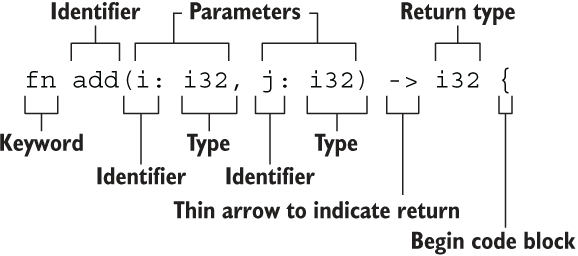

## 朱

知晓天空之蓝的人，一定很感性吧——黄昏时分，仿佛是伊卡洛斯在天空燃烧蜡质的羽翼，洒下金箔，血色染红了半边天。

雁阵惊寒，红色的落叶捎来冬天的讯息，带着落日的余温，款款地飞向大地。无需言语的摩挲，抑或窃窃地贴近，几乎是席卷般，眼前的天地变了颜色。

校园里的野狸，仿佛很胆小，当我凑近想要打个招呼，只是两步距离，就隐入草中，不见踪影。实是意兴阑珊，于是转入新的学习中——转入rust。

## 赤

rust是一门注重内存安全的，现代语言，大体功能与cpp相当，cargo工具链和包管理比cpp更加统一而易于跨平台迁移，通过将项目的构建成本从cpp传统的上线后暴露修复，前移到编译期的内存安全检查，和语法学习的复杂度上——是的，比传统的C族语言都要难以学习。下面作为引子，说道一二。

首先是工具链，对于简单的单个验证性文件我们采用如下方法：
```bash
mkdir test
vim test
```

然后在 INSERTE 模式下输入：

```bash
:e world_hello.rs
```

然后点击 Esc ，输入：

```bash
:wq
```

然后在终端输入：

```bash
vim world_hell.rs
```

在 INSERTE 模式下输入：

```rust
fn greet_world() {
    let southern_germany = "Grüß Gott!";
    let chinese = "世界，你好";
    let english = "World, hello";
    let regions = [southern_germany, chinese, english];
    for region in regions.iter() {
        println!("{}", &region);
    }
}

fn main() {
    greet_world();
}
```

然后同样保存退出，在终端运行：

```bash
rustc world_hello.rs
./world_hello
```

终端输出：

```markdown
Grüß Gott!
世界，你好
World, hello
```

同样的，我们运行下面文件：
```rust
fn main() {
    let x = 100;
    let y = 100;
    add(x, y);
}

fn add(x: i32, y: i32) {
    println!("x+y={}", x + y);
}
```

```rust
fn main() {
    let _x = 100;
    let _y = 100;

    add(3, 5);
}

fn add(x: i32, y: i32) {
    println!("x+y={}", x + y);
}
```

我们可以猜一下两者的运行输出结果，稍后揭晓。首先回顾在cpp中，我们常使用变量这个概念，以及指针，在物理内存上，编译期的变量并没有特殊的含义，只是一个内存的名字而已，根据生命周期的不同，存在于堆内存和栈帧上（cpp中的内存管理虽然部分地转为隐式的，但是还是保留了手动显式管理的方式，比如构造函数和析构函数，对于这两个函数我在之前的文章有讲）。

对于函数我贴一张图片
上面的函数形状与cpp无二，只是在类型的声明上略有不同，这也是比较像ts的形状。然后最明显的区别是“;”这个符号的作用，如果一个语句使用了“;”，闭合起来就是一个表达式，如果不闭合，那么就是一个返回值，给函数外部调用或读取。

然后，就是生命周期管理了，在我的示例代码中我使用了`“_x”`和`“_y”`，这个短下划线表示允许不使用，相反你可以在函数头写一个“#[must_use]”来给编译器放一个指令——“如果作者没有使用就报错”。因此第一个的输出是：x+y=200，第二个的输出是：x+y=8，如果你有兴趣的话可以测试一下，将第二个用例的变量的下划线去掉，就能看见两个报错。

## 绯

暂时就写到这吧，转rust耗费心力，几近力竭。

不自觉间，困倦地，下巴滑到支倚着的手心中，任遐思纷飞，逍遥作游。
